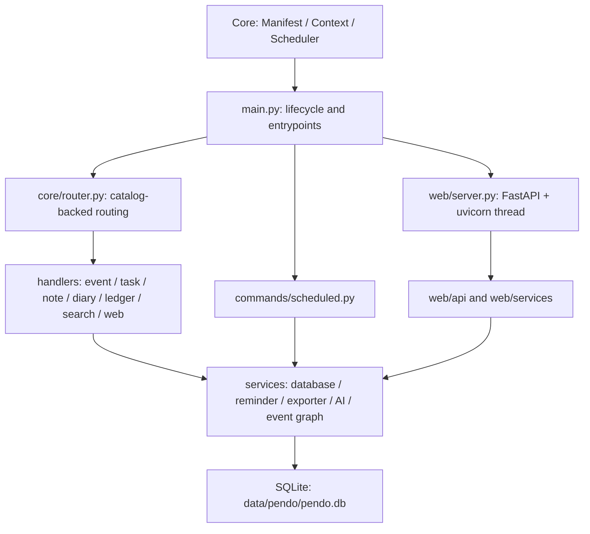
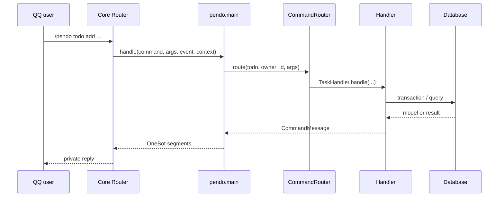

# 🏗️ Pendo architecture

[中文](ARCHITECTURE.md) | English

This document describes runtime ownership, command routing, business services, SQLite storage, scheduling, Web APIs, and extension procedures for Pendo maintainers. See [README.en.md](README.en.md) for user operations.

## 🏗️ Design objectives

- Chat, Web, and scheduled tasks share one business model and database.
- Each business record is isolated by `owner_id`.
- Timestamps are stored in UTC and displayed in the user's IANA timezone.
- One service acquires and releases lifecycle resources.
- Routing, models, and storage validate external input at each boundary.
- Persistent outboxes and acknowledgments advance delivery tasks.
- Web credential digests stay in the business database.

## 🏗️ Runtime layers



| Layer | Function |
| --- | --- |
| `main.py` | Lifecycle, Core entries, configuration subscription, command adaptation, and schedule adaptation |
| `core/` | Pendo types, exceptions, catalog routing, and context state |
| `commands/` | Top-level operations, settings, Session continuation, and scheduled business operations |
| `handlers/` | Module argument parsing and business operations |
| `models/` | Item data classes, enumerations, and serialization models |
| `services/` | Storage, reminders, event graphs, export, AI parsing, and lifecycle resources. `services/runtime.py` supplies `PendoRuntimeService` |
| `utils/` | Validation, formatting, timezone, settings, and database helpers |
| `web/` | FastAPI routes, authentication, analytics, Bundle transfer, Demo services, and static SPA |

## 🏗️ Lifecycle ownership

`PendoRuntimeService` is the internal service boundary for the database, configuration subscription, and Web service.

### Initialization

1. `main.init()` gets an atomic configuration snapshot from Core.
2. `PendoConfig.configure()` validates and publishes runtime settings.
3. `PendoRuntimeService.open_database()` resolves `context.data_dir/pendo.db`.
4. `Database` initializes connection settings and schema migrations.
5. The runtime service acquires ownership of the database singleton.
6. The configuration subscription callback binds to the current plugin generation.
7. The Web thread starts when `web_enabled` is true.

`context.state["pendo_runtime"]` holds the lifecycle service and business service collection visible to the current context. The module-level runtime service owns resources. Context state publishes that ownership to entries and callbacks.

### Configuration reload

The callback reads complete snapshots by revision number. It publishes new settings together after successful validation. Changes to Web `enabled`, `host`, or `port` cause an ordered stop and start. The database instance and business requests continue with the same published settings generation.

### Shutdown

`main.shutdown()` releases resources in this sequence:

1. Cancel the configuration subscription.
2. Stop the Web thread.
3. Clear the reminder singleton.
4. Detach the database singleton.
5. Close all SQLite connections registered by the runtime service.
6. Clear Context state for the current plugin generation.

Cleanup collects component exceptions. It continues to release the remaining owned resources.

## ⌨️ Command routing

Core identifies `/pendo` and shortcuts through `plugin.json`. Pendo builds its local routing table from Core `CommandCatalogNode`. Help, aliases, usage, and Manifest data thus share one source.



`CommandMessage` is the shared result structure between handlers and entries. `main.py` converts it to Core message segments. It sends exceptions through Pendo error mapping and the public error boundary.

`TRIGGER_SUBCOMMAND_MAP` maps `/日程`, `/待办`, and `/日记` to their canonical modules.

## 💬 Session flow

Multi-step task, ledger, and diary interactions use Core Session:

1. The handler creates a Session with `plugin_name=pendo`.
2. Session data holds the operation type, current step, and collected fields.
3. Core submits subsequent messages serially by user and chat scope.
4. `main.handle_session()` delegates to `commands/session.py`.
5. The module handler validates this step's input and updates state.
6. Completion, exit, timeout, or a state validation exception ends the Session.

Single-line commands and multi-step sessions use the same model validation and database write path.

## 🔄 Business handlers

| Handler | Main functions |
| --- | --- |
| `EventHandler` | Events, collections, nodes, recurrence rules, and reminder management |
| `TaskHandler` | Task creation, reading, updates, deletion, status, planned dates, deadlines, and interactive addition |
| `NoteHandler` | Notes, categories, tags, references, and related items |
| `DiaryHandler` | Diaries, template answers, moods, scores, and favorites |
| `LedgerHandler` | Income, expenses, transfers, accounts, amounts in cents, and statistics |
| `SearchHandler` | Full-text search across types and structured filters |
| `WebHandler` | Web lifecycle, login Codes, and Widget Tokens |

The event handler separates these functions:

- `event.py`: entry, reminder operations, and operations across modules.
- `event_editing.py`: edits, deletion, and collection changes.
- `event_views.py`: lists, details, and display queries.
- `event_support.py`: shared parsing and formatting helpers.

## 📌 SQLite storage

`Database` combines `WebAuthRepositoryMixin` and `ReminderRepositoryMixin`. It supplies business record operations, search, caching, transactions, authentication registries, and reminder leases.

### Connections and transactions

- Each worker thread uses a separate SQLite connection.
- Connections enable WAL, `synchronous=NORMAL`, foreign keys, and busy timeout.
- The runtime service registers connections and closes each one during shutdown.
- Explicit transactions and database locks keep writes consistent.
- Items and user settings have a `version` field for optimistic concurrency control.
- The query cache uses a 30-second TTL and a 1024-entry LRU. Related writes invalidate it. Reads record the cache generation before queries. Cache filling checks that generation after queries. This prevents an old query from replacing data after a write. Batch collection queries return their results directly and prevent repeated cache warmup.

### Schema

| Table | Relation |
| --- | --- |
| `items` | All business leaves and standard items |
| `event_collections` | One collection organizes multiple event leaves |
| `reminder_logs` | Reminder states, leases, and retry information |
| `scheduled_delivery_outbox` | Scheduled messages and acknowledgments for each target |
| `operation_logs` | Operation audits and undo snapshots |
| `user_settings` | Per-user settings and versions |
| `transfer_logs`, `imported_bundles` | Bundle import audits and identities |
| `login_code_registry` | Single-use Code digests |
| `web_session_registry` | Browser session digests and device information |
| `widget_token_registry` | Widget Token IDs and revocation states |
| `schema_migrations` | Applied migration records |

`services/db_schema.py` creates base tables and applies incremental column migrations by version. The startup transaction commits schema changes and version records together.

### Time and amounts

Complete instants use canonical UTC strings. `plan_date`, `diary_date`, and `ledger_date` use date values. API and command boundaries convert user local times through `TimezoneHelper`.

Natural-language year, month, day, and clock values are local wall-clock fields. Model conversion removes timezone offsets added by AI. The user or event IANA timezone then resolves the instant.

Ledger statistics use integer `amount_cents`. Displays use `amount`. Import normalizes both fields.

## 📅 Event graph

`event_collections` represents repeated events and events with multiple nodes. Event leaves in `items` reference collections through `event_collection_id`. Leaves also hold a role, index, node key, and source item.

`services/event_graph.py` manages collection creation, node consistency, occurrence operations, and checks across collections. Chat, Web APIs, export, and reminder queries share this graph model.

### Update and recovery contracts

Full Web edit forms include `version`. The server checks the read version, then checks it again inside the storage transaction. Conflicts return 409. A full edit without a version returns 422. Frontend error handling keeps dialog input.

An explicit `remind_times` submission clears stored rules before full normalization. When rules are also submitted, the explicit rules determine reminders. Deadline changes merge current rules and rebuild the queue.

Soft deletion clears pending reminders and keeps sent and confirmed history. Undoing deletion restores the item, full-text index, and reminder queue in one transaction. Unique keys in completed history prevent duplicate first delivery. Repeated events keep their original `DTSTART` and `COUNT`. Expansion filters historical instances.

`utils/currency.py` supplies currency normalization, labels, and grouping. Chat statistics, scheduled summaries, and Web aggregates group by currency before calculating income, expenses, and category metrics. Each currency keeps a separate measure. A separate data source and business contract are necessary for exchange-rate conversion.

## ⏰ Reminders and scheduled delivery

Reminder processing has four stages: discovery, claim, sending, and acknowledgment.

1. Query due reminders.
2. Acquire a time-limited claim in `reminder_logs`.
3. Build `send_private_msg` for the item owner, with a numeric QQ user target.
4. Complete or release the claim from the OneBot acknowledgment.

Claims record a token, expiry time, next-attempt time, and failure count. At item writes, `_sync_reminder_logs` synchronizes `items.remind_times` with `reminder_logs` and writes canonical `fire_at_utc`. Schema initialization manages tables, columns, and query indexes. Schedule queries use UTC with second precision. This model supports repeated schedule ticks and process restarts.

Web event details use the individual reminder confirmation endpoint to switch future reminders. `ReminderRepositoryMixin` checks the owner, event type, reminder membership, and trigger time in one immediate transaction. Early confirmation sets `preconfirmed` and clears the claim. Reopening sets the same reminder row to `pending`. The server checks expiry with UTC. Browser buttons also become disabled at expiry.

Periodic briefings, diary prompts, and financial summaries store period claims and acknowledgment states in `scheduled_delivery_outbox`. Core delivers these messages to user private chats in `targeted` mode.

`commands/scheduled.py` also coordinates task migration, log cleanup, and Demo data cleanup. Log and Demo cleanup use Core `silent` mode. Manifest entry `pendo_prune_operation_logs` binds to `scheduled_prune_operation_logs`. It removes expired operation logs and undo snapshots daily.

## 🔐 Web service boundaries

`web/server.py` runs a background uvicorn thread inside the Bot process. A module state lock limits the current process to one service thread. `PendoRuntimeService` manages its lifecycle. Bot restarts, plugin reloads, and the Pendo Web lifecycle stay synchronized.

The FastAPI application has these layers:

| Directory | Function |
| --- | --- |
| `web/api/` | Request models, authentication dependencies, and HTTP routes |
| `web/analytics/` | Dashboard and statistics query composition |
| `web/services/` | Bundle transfer and Demo space operations |
| `web/static/` | Native JavaScript SPA |
| `web/deps.py` | Database and session dependencies |
| `web/auth.py` | Code, Cookie Session, and Widget JWT |

API responses use the common `ok`, `message`, and `error_code` structure. Security headers include CSP, `X-Content-Type-Options`, and `Referrer-Policy`. Secure Cookie settings are necessary for LAN and public listeners. A TLS reverse proxy protects transport.

## 🌐 Web authentication flow

### Browser sessions

1. Generate a random login Code in QQ private chat.
2. Store its digest and 7-day expiry in `login_code_registry`.
3. Submit the Code from the browser.
4. Consume the Code and create a random 7-day Session in one transaction.
5. Give the browser an HttpOnly Cookie.
6. Query `web_session_registry` by Session digest for subsequent requests.
7. Delete the applicable registry record on logout or device revocation.

### Widget Token

1. Generate a 365-day JWT in QQ private chat.
2. Include the owner, token ID, issue time, expiry time, and widget scope.
3. Store the token ID, owner, expiry, and revocation state in `widget_token_registry`.
4. Check the JWT signature, scope, expiry, and registry state for `/api/widget/*`.
5. Update the current owner's valid records on revocation.

`/api/widget/summary` supplies up to 5 events and home-screen panels. `/api/widget/calendar` supplies all events in an inclusive interval of up to 3660 days.

Scriptable reads the Web address and Widget Token from the top of its source file. Keychain stores the last successful run date. Calendar synchronization always reads at least the past 30 days and the next 30 days. An earlier cursor extends the interval to cover the gap.

Each run reads one server window and one iOS target-calendar window. It adds, updates, and removes marked managed events by Pendo item ID. It advances the cursor after all reconciliation succeeds.

Both credential types use the same expiry convention with second precision. They have separate authentication dependencies and permission scopes.

## 📌 Bundle import and export

Transfer packages use LF-separated NDJSON records. Unicode characters, including U+2028 and U+2029, keep their values inside JSON strings. Each data file has a limit of 100,000 records. The six member types have a total limit of 600,000 records. Import and export share these limits.

Upload filenames enter `X-Transfer-Filename` with UTF-8 percent encoding. The server decodes them for audit records.

Markdown export uses the caller's timezone. Date ranges and rendering share that timezone. Time strings include offsets. Widget calendar fields give ISO times with offsets. Display dates use the user's local date.

`web/services/transfer_bundle.py` exports versioned `.pendo.zip` packages. `bundle_import.py` does checks, sample previews, and transaction execution. Import uses this sequence:

1. Validate ZIP entries, sizes, paths, and the manifest.
2. Validate file SHA-256 values and JSON structures.
3. Bind all owner fields to the current session user.
4. Resolve references and IDs across items.
5. Apply the skip, overwrite, or copy policy.
6. Write business tables and the Bundle identity in one transaction.
7. Write `transfer_logs`.

Chat `ExporterService` generates Markdown archives. Core file delivery sends them.

## 🔐 Concurrency boundaries

- Core executes Pendo commands according to the plugin Manifest.
- Core Session serializes submissions for one user and chat scope.
- SQLite write transactions protect consistency across threads.
- Database uses separate locks for settings, caches, and connection registration.
- A module-level reentrant lock protects Web server state.
- Reminder claims, outboxes, and database constraints coordinate scheduled tasks.
- The runtime service maintains one owner for the database, subscriptions, and Web service.

## 🔄 Extension procedures

### Add business commands

1. Add a command catalog node to `plugin.json`.
2. Implement argument parsing and business operations in the applicable handler.
3. Register the top-level module in the `main.py` handler map.
4. Reuse model validation, timezone handling, and database transactions.
5. Update user commands in README.
6. Add normal, boundary, permission, error, and concurrency tests.

### Add data fields

1. Update `models/item.py`.
2. Add a versioned migration in `services/db_schema.py`.
3. Update database serialization and deserialization.
4. Update commands, Web APIs, search, and Bundle transfer.
5. Test schema migration, round-trip serialization, and concurrent updates.

### Add Web functions

1. Define strict request models and routes in `web/api/`.
2. Get the database and authenticated session from `web/deps.py`.
3. Put compound operations in `web/services/` or shared business services.
4. Add a page module in `web/static/js/pages/`.
5. Add API, permission, tenant isolation, and browser behavior tests.

## ✅ Validation

Pendo regression tests are in `tests/plugins/pendo/`. They cover chat commands, Sessions, databases, reminder leases, Web authentication, APIs, Bundles, Demo mode, timezones, and lifecycle behavior.

```bash
python -m pytest -q tests/plugins/pendo
python -m ruff check plugins/pendo
python -m mypy plugins/pendo
```
